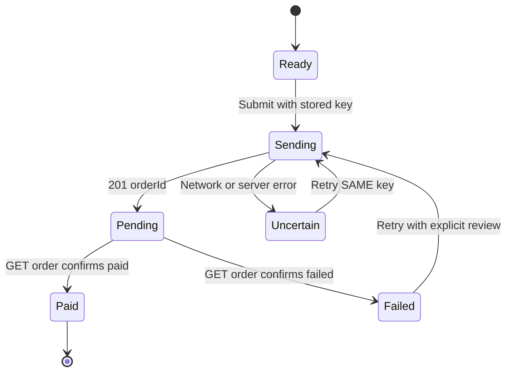

# MedEx Service Explorer

Next.js App Router / TypeScript / Tailwind CSS v4 / TanStack Query. No RHF: filters are not a submission form. Zod is intentionally omitted from the hot path; an API boundary schema is a sensible production extension. Controls use accessible native inputs and selects with shadcn-inspired styling rather than installing the full shadcn registry.

## Run

```bash
npm install
npm run dev
npm run typecheck
npm test
npm run build
```

Open http://localhost:3000. Mock endpoints: `/api/categories`, `/api/providers`, `/api/services` (independent). Each supports `?fail=1` and `?delay=1500`. Open `/?fail=1` to demonstrate error and retry; query initial data is still available as fallback. `?fail=1` is a demo switch and retry will continue failing until it is removed. Use browser devtools offline mode for the offline banner.

## Decisions

- **Visibility:** exclude inactive services, inactive providers, inactive parent categories, inactive subcategories, broken category references and mismatched parent/child relationships. Missing category IDs are allowed only when the service explicitly has no category. Unknown providers are excluded.
- **Category identity:** IDs are canonical; never use slug as the category key. `ultrasound` is shared across `package` and `lab_test`.
- **Money:** fixed-point micro-units with BigInt for intermediate operations. This prevents binary floating-point drift for ordinary API decimals; percent division truncates beyond six decimal places, a documented precision limitation. Invalid prices show “Ask for price” rather than invented amounts. Price sorting puts unpriced services last. Wellness uses the lowest valid duration option as a labelled indicative price; actual booking requires choosing an option.
- **Currencies:** no conversion or addition. Price filtering requires explicit THB/NPR/INR selection; prices in other currencies are excluded when a range is set. Without a range, all currencies remain visible. Global price sort compares nominal amounts across currencies, **not economic value**; production should require currency selection before enabling price sort.
- **Facets:** disjunctive counts: exclude the facet's own filter and retain every other active filter. Multi-select ORs within type/provider; AND across dimensions. Counts refer to services, not providers. Zero-count options are disabled but visible so customers understand unavailable combinations.
- **Relevance:** matching service title ranks above category title, then provider name; ties prefer rated providers then service title. With no search, rating and title determine order.
- **URL:** filters, sort and provider-group page are encoded in search parameters. The server reads them for the initial render, avoiding an initial unfiltered flash. Browser back/forward updates local state. Pagination is by provider group, eight groups per page; each card shows three services until expanded.
- **Search:** deferred search computation and debounced URL writes. Local keystrokes are not blocked by router navigation.
- **Layout:** result cards have predictable structure, but expanding services increases card height intentionally. A fully fixed-height results region would require virtualization and careful focus handling.

## Known limitations and follow-up work

- Mobile dialog has Escape handling and semantic dialog attributes, but **does not yet implement focus trapping, initial focus or focus restoration**. Add Radix Dialog for production-grade keyboard behavior.
- The initial dataset is server-injected into TanStack Query, so skeletons are primarily visible during client-only data loading; a dedicated loading route and a delayed server loader would make the skeleton state easier to demonstrate.
- Facet computation scans 3,200 items for each option. For much larger data, build inverted indices/bitsets and benchmark worker offloading.
- Category/provider facet counts for multi-select are self-excluding; some native select options cannot be chosen when zero, as intended.
- Current price calculations exclude optional home-test charges, since they are not part of the supplied final-price formula.
- No booking workflow, real exchange rates, or service-detail API is included in this task.

## Performance measurement (run locally)

Open Chrome Performance panel, use CPU 4x slowdown, record changing type/location/price filters with all 3,200 services loaded, and inspect scripting time and long tasks. Measure input latency with the Performance panel while typing one character at a time. The target is under ~100 ms per filter operation on a midrange laptop. **No measured timings are claimed here:** this repository was generated without a browser benchmark. Also inspect Layout Shift in Chrome Performance while filters update; skeletons and stable card wrappers reduce movement, but dynamic group counts can still shift the page. Record actual device/browser/results in your submission.

## Form and accessible component architecture

The price range uses React Hook Form with `zodResolver` and a cross-field Zod validation rule. Inputs are local drafts, so typing never triggers expensive faceted recalculations; **Apply price range** commits both values atomically to the URL. Price inputs require nonnegative decimals with at most two fractional digits. The currency selector remains a prerequisite for applying price constraints.

Reusable `components/ui/button.tsx` and `components/ui/input.tsx` follow the shadcn/ui source-owned component pattern (Radix Slot + Tailwind utilities); the mobile filter drawer uses Radix Dialog for focus trapping, Escape dismissal and focus restoration. This project does not claim to have been generated by the shadcn CLI.

TanStack Query continues to own the independent categories, providers and services API caches. The first server render receives the same URL-derived filters as the client, avoiding an unfiltered initial flash. The existing seeded query data is deliberately retained to support that first render.

### Verification to perform before submission

Run `npm install`, `npm run typecheck`, `npm test`, and `npm run build`. Then measure filter-to-paint latency with Chrome Performance on a midrange laptop; the 100 ms target is **not yet independently verified**. Test keyboard-only mobile drawer navigation, screen reader announcements, offline/retry behavior and multi-currency sorting. Avoid claiming these checks passed until they have been run.

## Task 2 — Multi-provider cart and split checkout

Visit `/cart` from the Explorer header. The Task 2 fixture is served through a mock server layer, not imported into the cart UI except for the explicit **Merge sample guest cart** demo action. The API adds 350 ms latency by default; the developer panel can select delays and fail individual endpoints.

### Architecture and decisions

- `lib/cart/model.ts`: types, Zod request schemas, duration-aware pricing, separate currency subtotals, and checkout eligibility.
- `lib/cart/store.ts`: server-side in-memory cart, guest merge, idempotent checkout and order status transitions. **Not durable across server restarts**; a real solution needs transactional database storage.
- `app/api/cart`, `app/api/checkout`, `app/api/orders`: mock HTTP endpoints with injected delay/error behavior.
- `components/cart/cart-page.tsx`: TanStack Query for server state, React Hook Form and Zod for payment method selection, optimistic quantity UI and order recovery display.
- Grouping follows the supplied API's `type` grouping, **not provider**; providers appear on individual lines. A type can contain multiple providers and currencies, and is checked out as one order in this exercise's interpretation.
- Missing product `{}` is visibly unavailable, cannot be checked out, and can be removed. Missing wellness duration is **unknown**, never zero. Prices in the cart fixture are final per unit, so no Task 1 discount calculation is repeated.
- Guest merge: same product and duration combines quantities (capped at 99); a guest duration can fill an unselected server wellness duration; other variants remain separate lines; unknown products are skipped with an explanation. Repeated manual merges are **not** idempotent: the sample button is a demonstration, not an actual login event.
- Quantity changes use a per-line async write loop. Rapid clicks update the displayed quantity immediately; only one request is in flight per line, and the latest desired quantity is sent after each response. Errors trigger refetch and a message. This avoids out-of-order writes on one line but concurrent changes from other tabs are not resolved.
- Checkout requests use a UUID idempotency key stored in `localStorage` with their snapshot. Retrying an uncertain submission reuses the same key. On reload, known order IDs are polled through `GET /orders/:orderId`. A real backend must persist idempotency records atomically with orders and use durable payment-provider idempotency as well.
- A bulk checkout submits eligible type groups individually with pay-at-clinic. Unavailable and unpriced groups are skipped rather than silently charging them. Individual groups support card or pay-at-clinic.

### Checkout state machine



### Honest limitations and next steps

This is a demo mock, not a payment system. The in-memory server state disappears when the Next.js server restarts. A checkout request that succeeds but loses its response **before the client receives its order ID** cannot be reconciled by `GET /orders/:id`; production requires `GET /checkout/by-key/:key` or a persisted checkout-session lookup. The demo card method does not collect or tokenize a card. Order statuses transition automatically after a short delay. The mock does not provide real multi-tab locking, inventory reservation, or provider-specific payment constraints. For production, introduce a database transaction for cart changes, durable idempotency keys, payment webhooks, authentication, reconciliation by key, and an explicit failed-payment retry flow. Measure accessibility and rapid-click behavior in a real browser before submission.

**AI disclosure:** ChatGPT assisted with code generation, architectural scaffolding, tests, and this README. All changes should be reviewed and explained by the submitting engineer.
